# Microsoft Entra ID — Automated Onboarding & Identity Protection


> 100 users provisioned from CSV through Microsoft Graph, then governed with dynamic groups, Administrative Units, Conditional Access, Identity Protection and Privileged Identity Management (PIM).

**Scenario:** an anonymised, mid-sized financial-services organisation. Onboarding was done by hand across five departments, which was slow and inconsistent and produced duplicate records and wrong permissions. Identity controls were weak: no consistent MFA, standing admin access and thin audit trails.

---

## Outcomes

| Area | Result |
|---|---|
| Bulk provisioning | ✅ **100 / 100 users** created from CSV via Microsoft Graph |
| Access model | 5 department groups with **dynamic membership**, 5 **Administrative Units**, job-based RBAC |
| Conditional Access | **7 policies** built and deployed in **Report-only** for impact analysis before enforcement |
| Identity Protection | User-risk and sign-in-risk policies with remediation paths |
| PIM / JIT | **5 privileged roles** moved to eligible, time-bound assignments with MFA, justification and approval; **access review every 2 weeks** |

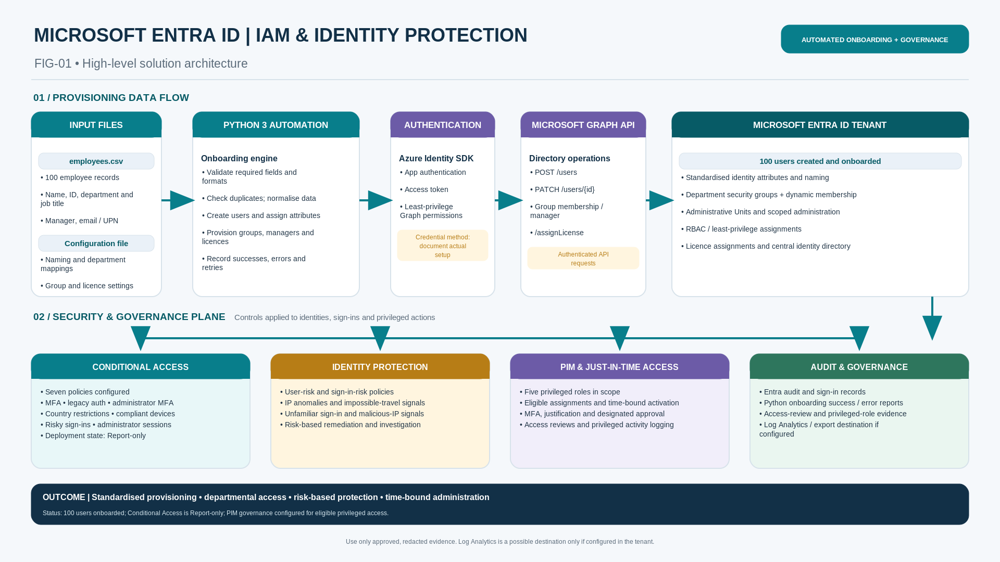

---

## 1. Python provisioning engine

A CSV-driven workflow replaces manual account creation. Code: [`provisioning/create_users.py`](provisioning/create_users.py)

```
users.csv ──► validate (Pydantic) ──► Microsoft Graph SDK (async) ──► Entra ID
                                                │
                                                ├─ create user + attributes
                                                ├─ resolve & assign manager
                                                └─ log success / failure ──► execution_log.txt
```

| Aspect | Implementation |
|---|---|
| Auth | Azure Identity `ClientSecretCredential` → `GraphServiceClient`. Secret supplied via environment, never committed |
| Validation | Pydantic model: display name, given name, surname and UPN required; department, job title, manager, usage location optional |
| Defaults | Mail nickname derived from UPN; temporary password generated if none supplied (never logged) |
| Manager links | Users created first, then managers linked in a second pass using a UPN → object ID map built during the run (95 manager links set) |
| Resilience | Per-row exception handling: one bad row is logged and the run continues |
| Logging | INFO-level, timestamped, to console and `execution_log.txt` |

**Run result:** 100 accounts created and 95 manager relationships assigned across Finance (20), HR (13), IT (20), Operations (25) and Security (22). See the [sanitised run log](docs/sample-execution-log.txt).

### Run it

```bash
cd provisioning
pip install -r requirements.txt
export ENTRA_TENANT_ID=... ENTRA_CLIENT_ID=... ENTRA_CLIENT_SECRET=...   # see .env.example
python create_users.py
```

The app registration needs the Microsoft Graph application permission `User.ReadWrite.All`, with admin consent. The sample [`users.csv`](provisioning/users.csv) uses a placeholder `contoso.onmicrosoft.com` domain, so change it to your tenant's domain first.

**Known gaps (on the backlog below):** no pre-check for existing users (not idempotent), no retry/back-off for HTTP 429, and processing is sequential even though the calls are async.

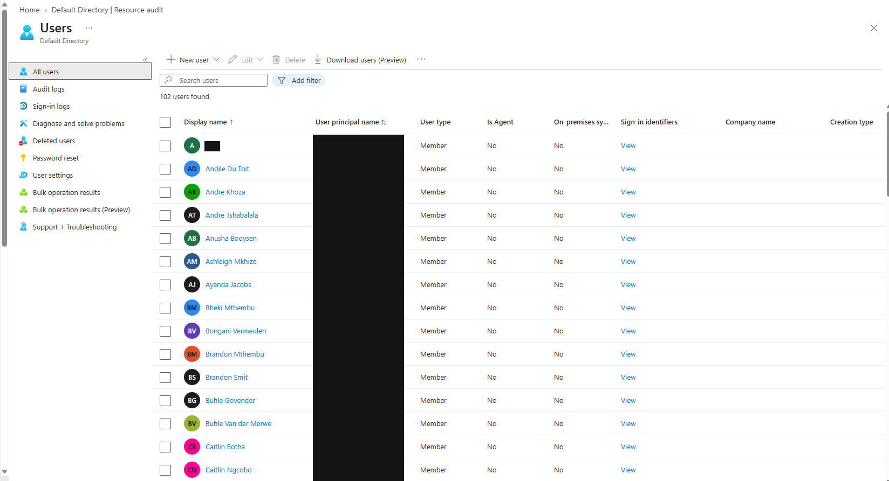

---

## 2. Identity & access model

**Standardised identities:** every user has department, job title, manager and usage location set consistently.

**Dynamic groups:** membership follows the HR attribute, so movers are re-grouped automatically:

| Group | Rule |
|---|---|
| Finance-Users | `user.department -eq "Finance"` |
| HR-Users | `user.department -eq "HR"` ⚠️ |
| Operations-Users | `user.department -eq "Operations"` |
| IT-Users | `user.department -eq "IT"` ⚠️ |
| Security-Users | `user.department -eq "Security"` |

> ⚠️ **Bug found during review:** the HR and IT rules match on the abbreviations `"HR"` and `"IT"`, but the source data (`users.csv`) uses the full values `"Human Resources"` and `"Information Technology"`. Entra compares the whole string, so **HR-Users and IT-Users miss all 33 HR and IT users**. Finance, Operations and Security are unaffected.
>
> **Fix:** change the rules to `user.department -eq "Human Resources"` and `user.department -eq "Information Technology"` *(or normalise department values in the source data)*, then confirm 13 and 20 members. **Lesson:** a dynamic group rule should be tested against the real attribute values, and membership checked after processing, before access is built on it.

**Administrative Units:** one per department, so delegated admins manage only their own unit and not the whole tenant.

**RBAC by job function:** IT support gets Helpdesk Administrator (scoped), security analysts get Security Reader (read-only), identity admins get User Administrator (scoped). Privileged roles are never standing; they go through PIM.

| | |
|---|---|
| 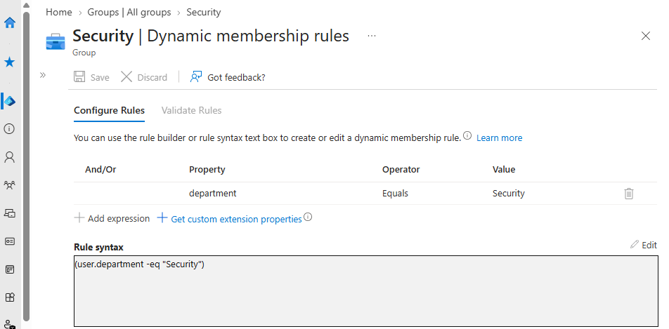 | 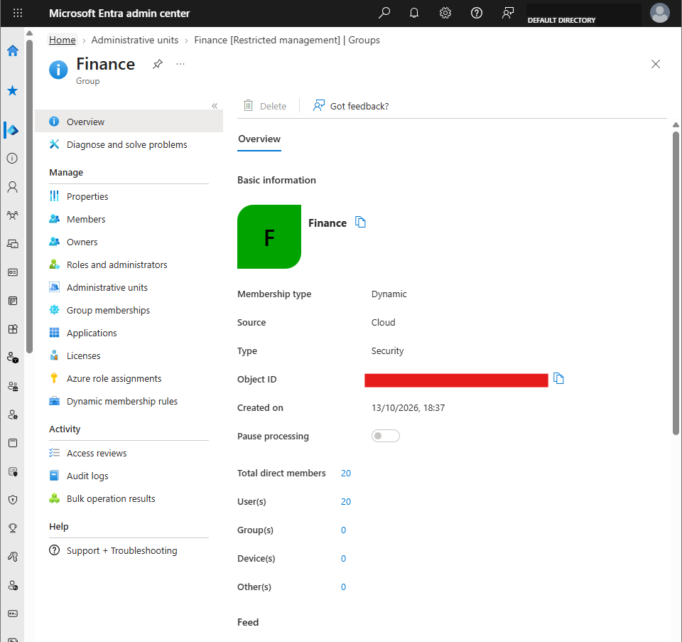 |

---

## 3. Conditional Access (7 policies, Report-only)

| # | Policy | Threat addressed | Control |
|---|---|---|---|
| 1 | Require MFA for all users | Phishing, credential replay | Require MFA |
| 2 | Block legacy authentication | Protocols that bypass MFA | Block |
| 3 | Require MFA for administrators | Privileged-account takeover | Require MFA |
| 4 | Restrict access from high-risk countries | Unapproved geographies | Block (named location) |
| 5 | Require compliant / hybrid-joined device for admins | Unmanaged admin endpoints | Require compliant device |
| 6 | Require MFA for risky sign-ins | Suspicious authentication | MFA on medium/high sign-in risk |
| 7 | Session controls for administrators | Session hijacking | 4-hour sign-in frequency, no persistent browser |

Emergency-access (break-glass) accounts are excluded from every policy.

**Why Report-only?** Turning on 7 policies at once in a live tenant is the classic way to lock everyone out, admins included. Report-only logs what *would* happen on each sign-in, so you can check impact and exclusions first and then enforce in stages. **These policies are evaluated but not yet enforced.**

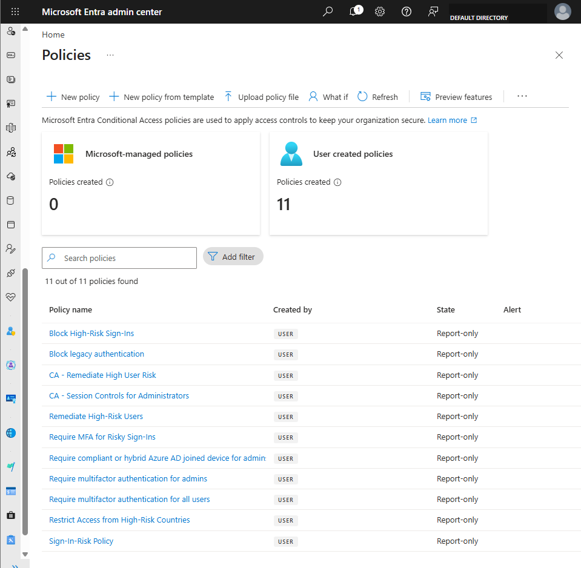

<details>
<summary><b>Policy configuration screenshots</b></summary>

| | |
|---|---|
| 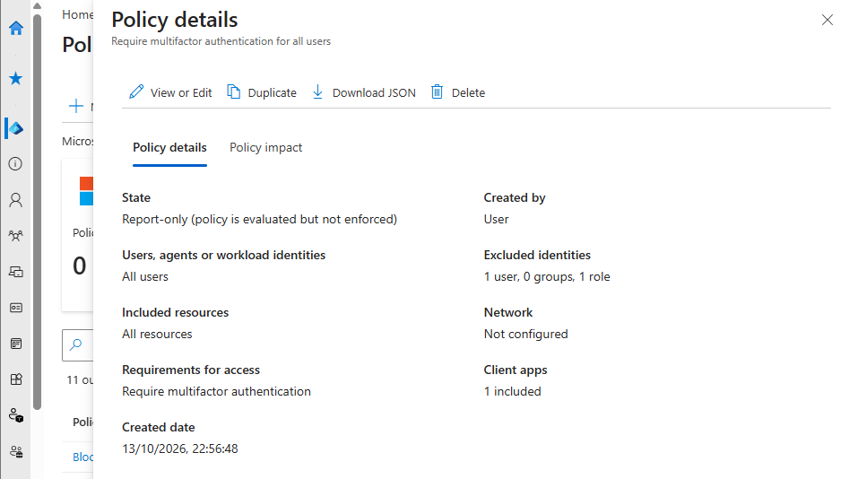 | 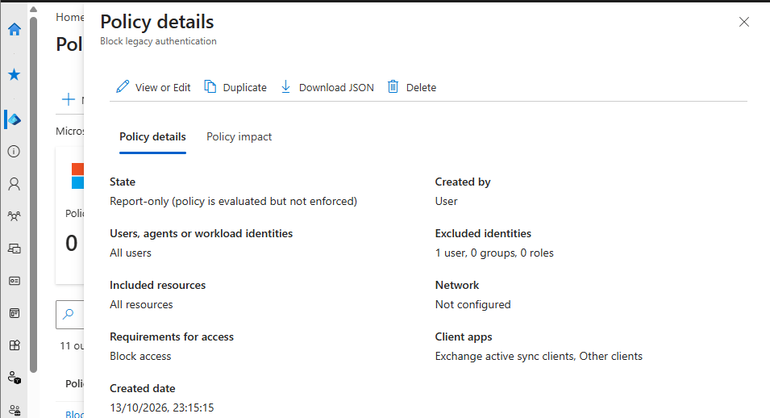 |
| 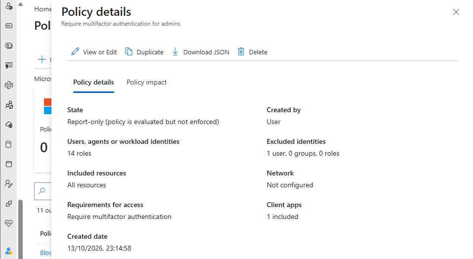 | 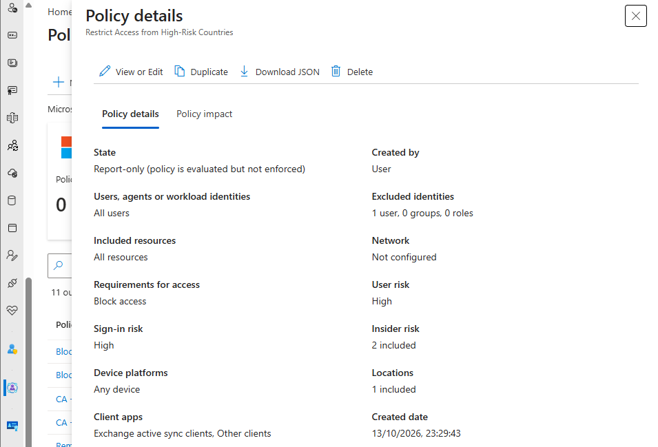 |
| 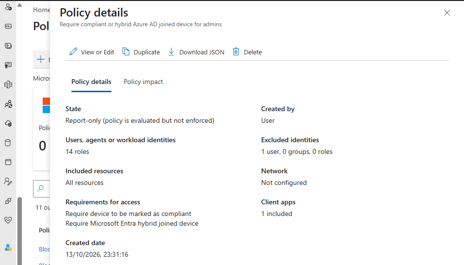 | 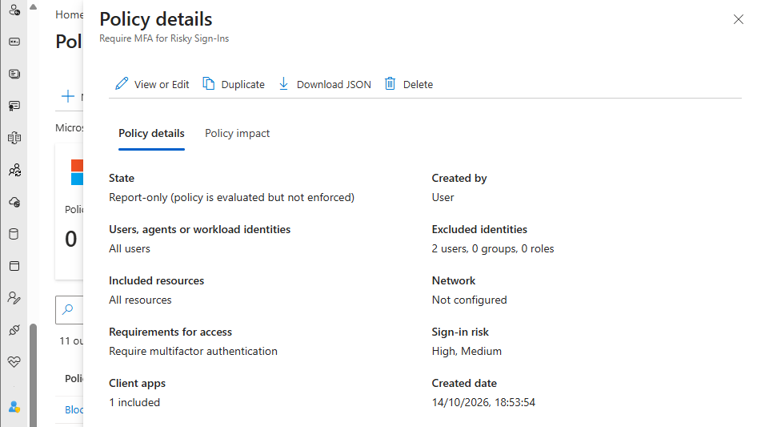 |
| 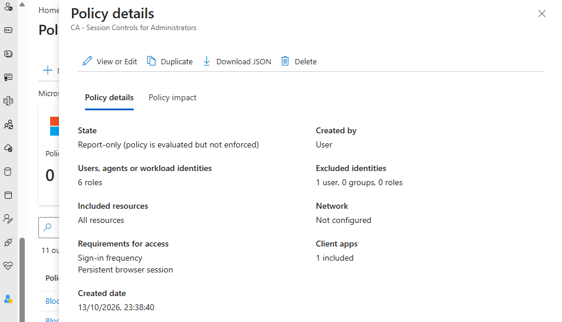 | |

</details>

---

## 4. Identity Protection

| Policy | Trigger | Response |
|---|---|---|
| Remediate high user risk | User risk = High | Secure password change / risk remediation |
| Risky sign-in | Sign-in risk = Medium or High | Require MFA |
| Block high-risk sign-ins | Sign-in risk = High | Block |

Detections in scope: anonymous / malicious IPs, impossible and atypical travel, and unfamiliar sign-in properties. Some detections need Entra ID P2.

---

## 5. Privileged Identity Management & just-in-time access

**Roles protected:** Global Administrator · Security Administrator · User Administrator · Exchange Administrator · Privileged Role Administrator

| Setting | Value |
|---|---|
| Assignment type | Eligible only, time-bound (no permanent assignments) |
| On activation | Azure MFA + business justification |
| Approval | Required for high-privilege roles, by designated approvers |
| Activation window | 1–2 hours max, then automatic expiry |
| Access review | Every 2 weeks; non-response = **remove access**; results auto-applied |
| Audit | Activation, justification, approver and expiry traced in PIM history and Entra audit logs |

```
request eligible role ─► MFA + justification ─► approver ─► active (≤2h) ─► auto-expire ─► audit
```

| | |
|---|---|
| 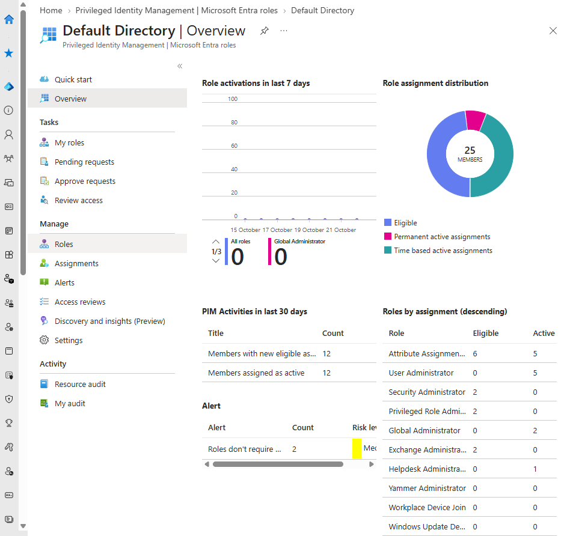 | 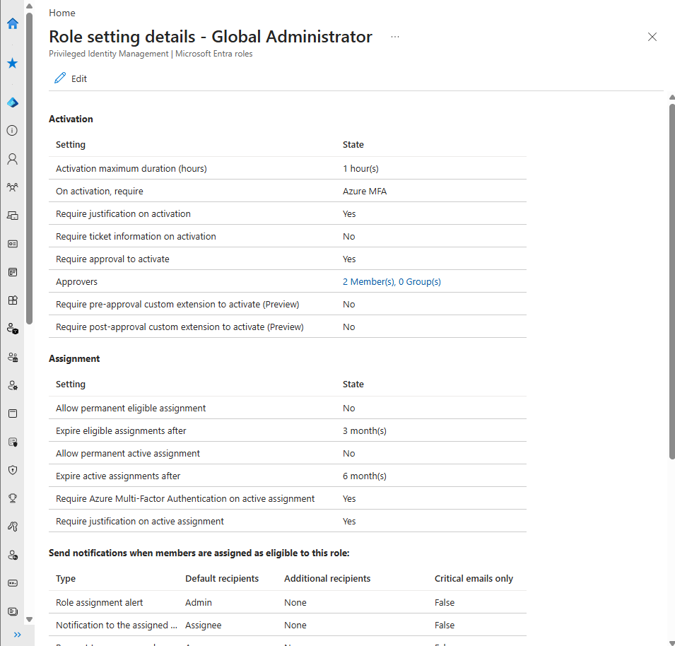 |
| 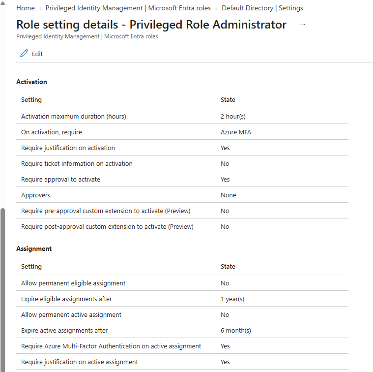 | 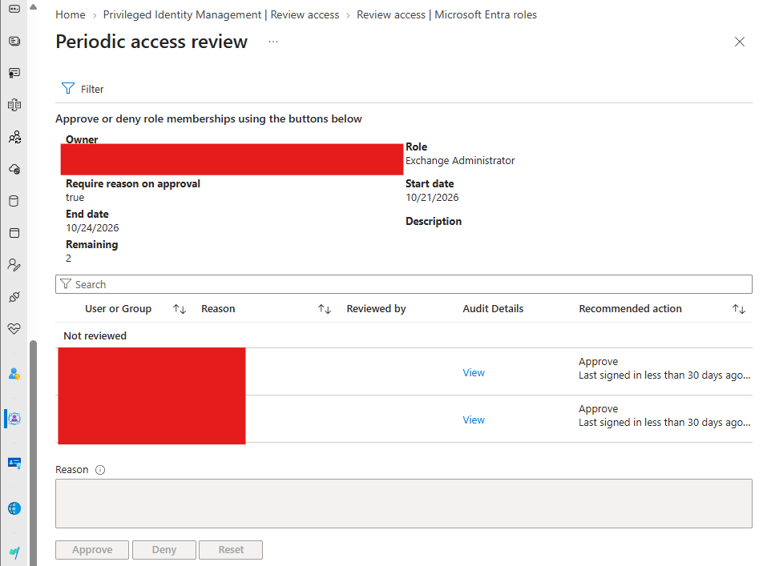 |

---

## Test results

| ID | Component | Status |
|---|---|---|
| T-01 | Bulk provisioning: 100 records | **PASS** (100/100) |
| T-02 / T-03 | Standard attributes, department groups | Implemented |
| T-04 | Dynamic membership rules | Configured. HR and IT rules don't match source data (see bug note) |
| T-05 | Administrative Units and scoped RBAC | Configured |
| T-06 | Conditional Access | Configured, **Report-only** |
| T-07 | Identity Protection risk policies | Configured |
| T-08 / T-09 | PIM activation and access reviews | Configured |
| T-10 | Audit logging | Configured |

I keep three levels separate: **configured** (built), **confirmed** (result observed) and **enforced** (switched on and tested). A screenshot of a saved policy proves it's configured, not that it's enforced.

---

## Framework alignment

| Framework | Mapping |
|---|---|
| Microsoft Zero Trust | *Verify explicitly* (MFA, CA) · *Least privilege* (RBAC, AUs, PIM, JIT) · *Assume breach* (Identity Protection) |
| NIST CSF | Identify (identity inventory) · Protect (MFA, CA, RBAC) · Detect (risk detections) · Respond (risk remediation) |
| CIS Controls v8 | Account Management, Access Control Management, Audit Log Management |
| ISO/IEC 27001 | Provisioning, privileged-access restriction, role-based access, logging, periodic review |

---

## Roadmap

- [ ] Fix HR / IT dynamic rules to match source department values and confirm membership
- [ ] Staged enforcement of Conditional Access: pilot group, review sign-in logs, then switch On
- [ ] Idempotent provisioning: check for existing users before create, and reconcile
- [ ] Retry with exponential back-off on Graph 429 / 5xx
- [ ] `--dry-run` mode, structured JSON logs, end-of-run summary and non-zero exit on failures
- [ ] Certificate or managed-identity auth instead of a client secret
- [ ] Unit tests for validation and Graph error paths, run in CI
- [ ] Export sign-in and audit logs to Log Analytics / Sentinel

---

## Repository structure

```
.
├── provisioning/
│   ├── create_users.py      # Async Graph provisioning engine
│   ├── config.py            # Reads tenant/app settings from environment
│   ├── users.csv            # 100 synthetic employees (placeholder domain)
│   ├── requirements.txt
│   └── .env.example
└── docs/
    ├── sample-execution-log.txt
    └── images/              # Redacted Entra admin centre evidence
```

---

**Skills shown:** Microsoft Entra ID · Microsoft Graph API · Python automation · Conditional Access design · Identity Protection · PIM / JIT · least-privilege RBAC · Zero Trust

*Built in a personal Entra ID lab tenant (P1). All users are synthetic. Tenant IDs, UPN domains, object IDs and the admin account have been redacted from screenshots.*
